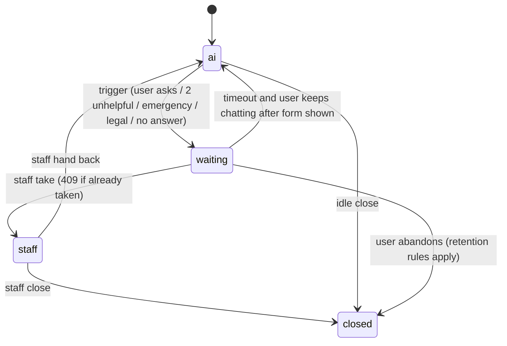

# Architecture.md — PropertyDek Assistant (`pdagent`)

Research date: 1 November 2026. Every version below was checked against a live source in that session (source column). Anything marked **VERIFY** was not checked and must be confirmed in Phase 0 before it is relied on. Versions go stale: when this file is older than 8 weeks, re-run the checks before starting a new phase.

## 1. Tech Stack (locked — do not substitute without updating this file first)

| Layer | Choice | Version (researched) | Reasoning / source |
|---|---|---|---|
| Language | Python | **3.14** (3.14.8, bugfix status). 3.15 was released 9 Oct 2026 — do not use yet | Python has no LTS; 3.14 is the newest line with a full year of wheels. Move to 3.15 after Pydantic, psycopg and the LLM SDKs publish 3.15 wheels. Source: python.org downloads, devguide status page |
| Package manager | uv | latest (resolve at install) | FastAPI's own docs now default to uv projects. Commit `uv.lock` |
| API framework | FastAPI | **0.162.x**, pin `~=0.162.0` | 0.x ships breaking changes in minor releases: 0.143, 0.145–0.151, 0.155, 0.160 and 0.162 were all breaking within three weeks. Upgrade only after reading the release notes and running the full suite. Source: fastapi.tiangolo.com/release-notes |
| ASGI toolkit | Starlette | 1.x, comes with FastAPI (1.7.0 in FastAPI's own lock on 7 Oct) | Do not pin separately |
| Validation | Pydantic v2 | resolved by lock | Pydantic v1 migration page still exists; never use v1 APIs |
| Streaming | FastAPI built-in SSE (`EventSourceResponse`, `ServerSentEvent`) | in 0.162 | Replaces hand-rolled `StreamingResponse` SSE. Source: FastAPI reference "Server-Sent Events" |
| Database | PostgreSQL | **18** (18.6 current; 17/16/15 also supported; 14 ends 12 Nov 2026). 19 was still beta on the last check, do not use | RDS supports 18.x from 18.1. Source: postgresql.org, AWS What's New 14 Nov 2025 |
| Vector | pgvector | **0.8.1** (what RDS ships with PG 18) | 0.8.0 added iterative index scans for filtered searches. Source: AWS What's New |
| ORM | SQLAlchemy | **2.1.x** (2.1.3 on 2 Oct; 2.1.4 reported 7 Oct) | 2.1 changed the default `postgresql://` driver to **psycopg 3** (was psycopg2). Source: sqlalchemy.org blog/docs |
| DB driver | psycopg 3 (`psycopg[binary,pool]`) | resolved by lock | Same driver for SQLAlchemy, the queue and raw SQL. One driver only |
| Migrations | Alembic | resolved by lock | Migrations run as a separate DB role (Rules.md §5) |
| Vector client | `pgvector` (Python package) | resolved by lock | Registers the vector type with psycopg 3 and SQLAlchemy |
| Job queue | Procrastinate (PostgreSQL-based) | 3.x (3.5.3 seen on PyPI) | Jobs are enqueued in the same transaction as the row that needs them (a document row and its ingestion job commit together). No second broker. **ARQ rejected**: repository marked maintenance-only at 0.28.0. Risk: Procrastinate's README asks for more maintainers. Task bodies are plain async functions, so a swap is cheap |
| Cache / limits / pub-sub | Redis-compatible store (ElastiCache) | **VERIFY** engine and version offered in FBC's AWS account | Used only for rate limits, spend counters, confirmation nonces and staff-inbox pub/sub. Nothing durable lives here |
| MCP server + client | `mcp` Python SDK | **2.0.x** (stable 28 Jul 2026), pin `>=2.0,<3` | Spec **2026-07-28** is the current revision: stateless, no `initialize`, no `Mcp-Session-Id`, `server/discover`, roots/sampling/logging deprecated. SDK v2 serves 2025-era clients from the same server. **FastMCP was renamed `MCPServer`**; import from `mcp.server.mcpserver`. The standalone `fastmcp` package pins `mcp<2` — do not use it. Source: modelcontextprotocol.io changelog, python-sdk v2.0.0 release |
| LLM primary | Anthropic `claude-sonnet-5-5` (agent turns, triage) and `claude-haiku-5-5` (routing, FAQ, status) | SDK `anthropic` **1.x**, pin `>=1,<2` | Sonnet 5.5: $2 in / $10 out per 1M tokens, cache read $0.10, 5-min cache write $2.50, 1M context. Haiku 5.5: $0.10 / $0.50, cache read $0.01, **prompt-length cliff at 100K tokens (5x above)**. Source: platform.claude.com model pages, checked 1 Nov |
| LLM fallback | OpenAI Responses API (`gpt-6.1-sol` large, `gpt-6-luna` small) and Google Gemini API (`gemini-4-argon` large, `gemini-3.8-flash` small) | SDKs `openai` **3.x** (`>=3,<4`) and `google-genai` **2.x** (`>=2,<3`) | 3-provider failover ring (`anthropic` ▸ `openai` ▸ `gemini`). Gemini 2.5/3.8 Flash uses a 2,048-token cache floor; Gemini 4 Argon uses a 4,096-token implicit cache floor. Failover pairs must pass the eval suite before serving |
| Embeddings | OpenAI `text-embedding-3-small`, 1536 dims | n/a | $0.02 per 1M tokens. No successor on OpenAI's model pages as of Sept 2026. Anthropic offers no embedding model. Vectors from different models are not interchangeable — see §7f for what happens when embeddings are down |
| Auth tokens | PyJWT (`pyjwt[crypto]`) with asymmetric keys (RS256 or ES256) and JWKS from PropertyDek | resolved by lock | PyJWT is what FastAPI's own security docs use |
| HTTP client (outbound) | Whatever the SDKs and FastAPI's TestClient require — **httpx2** | resolved by lock | Both `anthropic` 1.0 (20 Aug) and `openai` 3.0 (12 Aug) moved from `httpx` to the Pydantic-maintained fork `httpx2`; FastAPI added `httpx2` to its optional dependencies in 0.143.4. Do not add legacy `httpx` mocks for LLM calls (Rules.md §2) |
| Observability | OpenTelemetry (API/SDK + OTLP exporter), structured JSON logs | resolved by lock | FastAPI 0.142 added native OTel; **0.143 made automatic exporter setup opt-in**. Configure providers and exporters explicitly in `core/telemetry.py` |
| Widget | Lit 3.3.x web component, TypeScript, Vite | Lit 3.3.3 seen; TS and Vite resolved by lock | One custom element, Shadow DOM, small bundle for metered phones. Build tooling only runs on **Node.js 26** (Active LTS from 28 Oct 2026; Node 24 moved to maintenance 20 Oct; Node 22 ends 30 Apr 2027) |
| Lint / format | Ruff | 0.16.x (0.16.0 released 23 Jul 2026) | One tool for lint and format |
| Types | mypy, strict | resolved by lock | `ty` is used inside FastAPI's repo but was not evaluated here |
| Tests | pytest (pin `>=9,<9.2`, FastAPI pinned below 9.2 for xdist compatibility), pytest-asyncio, pytest-cov, testcontainers (Postgres) | resolved by lock | Real Postgres in tests; RLS cannot be tested on SQLite |
| Container / deploy | Docker, AWS ECS Fargate, RDS PostgreSQL 18, ElastiCache, S3, GitHub Actions | **VERIFY** against FBC's existing setup | Match FBC's setup if it differs (Memory.md Q7) |
| Outbound SMS | Provider adapter interface; provider is an open question (Memory.md Q3) | n/a | No provider SDK is chosen until FBC answers |

### Superseded or renamed things the training data gets wrong — do not use
- `from mcp.server.fastmcp import FastMCP` / standalone `fastmcp` → `from mcp.server.mcpserver import MCPServer` (SDK v2).
- MCP `initialize`, `Mcp-Session-Id`, sticky sessions → none exist in 2026-07-28. Cross-call state is passed as explicit IDs in tool arguments.
- MCP HTTP+SSE transport → deprecated; use Streamable HTTP.
- `temperature`, `top_p`, `top_k` on `anthropic` 1.x → raise `TypeError`. Control behaviour with the model's effort setting and `max_tokens`.
- `anthropic.Completions` (Text Completions) → removed in 1.0.
- `FastAPI(root_path=...)`, `openapi_prefix`, `**extra` on `Query/Path/Header/Cookie/Body/Form/File` → deprecated or removed (0.145, 0.146, 0.155). Use `fastapi run --root-path` and `json_schema_extra`.
- Automatic OTel exporter setup in FastAPI → opt-in since 0.143.
- psycopg2 as the default SQLAlchemy Postgres driver → psycopg 3 in SQLAlchemy 2.1.
- ARQ for new projects → maintenance-only.
- Claude 4.x / Sonnet 4.5 model IDs → Sonnet 4.5 retires 30 Nov 2026; not used.
- Node.js 20 and 25 → end of life.

## 2. High-Level Architecture

```
 Tenant app (iOS/Android)   Management app   Web dashboard (widget)   SMS provider
        │  HTTPS+SSE              │ HTTPS+SSE+WS       │ HTTPS+SSE            │ webhook
        └─────────────┬───────────┴──────────┬─────────┴──────────────────────┘
                      ▼                      ▼
              ┌───────────────────────────────────────────┐
              │ pdagent API  (FastAPI, stateless, ECS)    │   ZONE A: client-facing
              │  auth ▸ limits ▸ emergency rules ▸ turn   │   holds NO provider keys
              └──────┬───────────────┬───────────────┬────┘   other than via gateway
                     │               │               │
        ┌────────────▼───┐   ┌───────▼────────┐  ┌───▼─────────────────┐
        │ Agent loop      │   │ Postgres 18     │  │ Redis               │
        │ (in-process)    │   │ + pgvector      │  │ limits, spend,      │
        │ provider gateway│   │ RLS on all      │  │ pub/sub             │
        └──────┬─────┬────┘   │ tenant tables   │  └─────────────────────┘
   Anthropic ◄─┘     └─► OpenAI (failover)   ▲
                     │                        │ jobs (Procrastinate)
              ┌──────▼──────────────┐   ┌─────┴───────────────┐
              │ MCP server          │   │ Worker (same image)  │  ingestion, SMS send,
              │ (MCPServer, stateless│  │ ▸ extract ▸ chunk ▸  │  retention sweeps,
              │  Streamable HTTP)   │   │   embed ▸ store      │  eval runs
              └──────┬──────────────┘   └─────────────────────┘
                     │  user-scoped token (never a service token)      ZONE B: acts as the user
                     ▼
              PropertyDek API (FBC's existing backend)               ZONE C: system of record
```

Zones. A compromised model or prompt can only reach what the user's own token can reach in PropertyDek (Zone C), because the MCP server (Zone B) holds no credential of its own that is broader than the user's. The agent process never holds a PropertyDek service credential. Write tools additionally need a confirmed `confirmations` row.

## 3. Backend Folder Structure

Rule: feature-first. Each feature folder owns its router, service, repository, schemas and tests. No global `controllers/`, `models/`, `routes/`. Cross-feature calls go through a feature's `service.py`, never its repository.

```
pdagent/
├─ pyproject.toml            uv.lock            .python-version (3.14)
├─ alembic.ini               Dockerfile         docker-compose.yml
├─ CLAUDE.md                 PRD.md  Architecture.md  Rules.md  Phases.md  Design.md  Memory.md
├─ migrations/               (Alembic; every tenant table gets RLS in the same revision)
├─ config/
│   ├─ models.yaml           model IDs, prices (dated), route table, effort per route
│   ├─ emergency_rules.yaml  keyword rules (owned by FBC, versioned in git)
│   └─ prompts/              system.md, org_block.md.j2, triage.md  (prompt files are code: versioned, evaluated)
├─ src/pdagent/
│   ├─ main.py               app factory, lifespan, router mounting
│   ├─ core/                 settings.py  db.py  rls.py  errors.py  logging.py  telemetry.py  ids.py (uuid7)
│   ├─ auth/                 token.py (JWKS verify)  principal.py  deps.py  exchange.py
│   ├─ limits/               ratelimit.py  spend.py  breaker.py
│   ├─ audit/                service.py  models.py
│   ├─ conversations/        router.py  service.py  repo.py  schemas.py  stream.py  summary.py
│   ├─ agent/
│   │   ├─ loop.py           the turn loop (caps enforced here)
│   │   ├─ router.py         label + model route (rules first, small model second)
│   │   ├─ context.py        prompt assembly in cache-stable order
│   │   ├─ canonical.py      provider-neutral message/tool-call types
│   │   └─ providers/        base.py (LLMProvider protocol)  anthropic.py  openai.py  gemini.py  fake.py
│   ├─ knowledge/            router.py  service.py  repo.py  ingest/ (extract.py chunk.py embed.py jobs.py)  retrieve.py
│   ├─ tools/                registry.py (per-role tool sets)  schemas.py  confirm.py
│   ├─ mcp_server/           server.py  tools_read.py  tools_write.py  pdapi_client.py
│   ├─ handoff/              router.py  service.py  states.py  emergency.py  notify.py
│   ├─ inbox/                router.py  service.py  repo.py  ws.py            (staff inbox API, F7)
│   ├─ channels/             sms/ (webhook.py  adapter.py  parse.py)  web/ (embed token helpers)
│   ├─ triage/               service.py  schemas.py  photos.py
│   ├─ settings_org/         router.py  service.py  repo.py
│   ├─ evals/                runner.py  cases/ (yaml)  graders.py  report.py
│   └─ workers/              app.py (Procrastinate app)  periodic.py (retention, budget rollups)
└─ tests/
    ├─ unit/  integration/ (testcontainers)  isolation/  injection/  emergency/  evals/
    └─ conftest.py           two-org fixture, fake provider, token minting helper
```

## 4. Widget Folder Structure (`/widget`, same repo)

```
widget/
├─ package.json  .nvmrc (26)  tsconfig.json (strict)  vite.config.ts  index.html (dev harness only)
├─ playwright.config.ts        e2e + a11y runner (320 px and 1280 px projects)
├─ dev/dev-issuer.ts           local-only JWKS + token issuer for the Vite dev server (§6.9)
├─ scripts/                    check-spacing.mjs  check-contrast.mjs  check-bundle.mjs  (CI checks, Design.md §4, §8, Phases.md 7)
├─ src/
│   ├─ pdk-assistant.ts        <pdk-assistant> custom element (public API: attributes, events)
│   ├─ api/                    client.ts  sse.ts  types.ts (generated from the OpenAPI schema)
│   ├─ state/                  conversation.ts  confirm.ts  handoff.ts
│   ├─ components/             launcher.ts  panel.ts  message.ts  source-chip.ts  confirm-card.ts
│   │                          handoff-banner.ts  composer.ts  typing.ts  error-row.ts  empty-state.ts
│                          degraded-notice.ts  icons.ts (inline SVG, Design.md §9)
│   ├─ styles/                 tokens.css.ts (see Design.md)  base.css.ts
│   └─ i18n/                   en.ts  (strings only; no copy in components)
└─ tests/                      unit (vitest)  a11y (axe)  e2e (Playwright, 320 px and 1280 px)
```
Mobile apps do not use the widget; they call the same conversation API and render the same states (Design.md §6 lists the states to mirror).

## 5. Core Data Model

All ids are UUIDv7 generated by the database (`uuidv7()` exists in PostgreSQL 18). Every tenant table has `org_id uuid not null` and an RLS policy (§6). Soft-delete is not used for messages; retention deletes rows. Documents use a status column so a replaced version stops answering before its chunks are deleted.

| Table | Columns | Notes |
|---|---|---|
| `conversations` | id, org_id, property_id, user_id, user_role, channel (`web`,`app`,`sms`), status (`ai`,`waiting`,`staff`,`closed`), assigned_to, summary, summary_upto_seq, last_seq, unhelpful_count, created_at, updated_at, closed_at, retention_until | one per user per channel thread; `last_seq` is advanced with `UPDATE … RETURNING` inside the message insert transaction |
| `messages` | id, org_id, conversation_id, seq (bigint, unique with conversation_id), role (`user`,`assistant`,`staff`,`event`), content, attachments jsonb, route (`rules`,`small`,`large`), provider, model, input_tokens, output_tokens, cache_read_tokens, cache_write_tokens, reasoning_tokens, cost_usd numeric(10,6), latency_ms, ttft_ms, created_at | PII is stored here and nowhere else except attachments in S3. Logs never copy `content` |
| `tool_calls` | id, org_id, message_id, tool, args jsonb, args_hash, status (`ok`,`error`,`denied`,`awaiting_confirm`), upstream_status, result_summary (short, no PII), latency_ms | `args` is stored for audit; access limited to the same roles as transcripts |
| `confirmations` | id, org_id, conversation_id, user_id, tool, args jsonb, args_hash, status (`pending`,`confirmed`,`expired`,`void`), expires_at, confirmed_at, created_at | single use; partial unique index on `(conversation_id, tool, args_hash) where status='pending'` |
| `documents` | id, org_id, property_id (null = org-wide), type, title, version, status (`processing`,`ready`,`failed`,`replaced`,`deleted`), s3_key, sha256, created_by, created_at | one `ready` version per logical document |
| `chunks` | id, org_id, property_id, document_id, ordinal, heading_path, text, token_count, embedding vector(1536), tsv tsvector (generated, `english` config) | btree on `(org_id, property_id)`, GIN on `tsv`. **No HNSW index at launch** (§7b) |
| `handoffs` | id, org_id, conversation_id, reason (`user_request`,`unhelpful`,`emergency`,`legal`,`no_answer`), requested_at, taken_by, taken_at, released_at, timeout_at, outcome (`resolved`,`timeout_form`,`released_to_ai`) | at most one open handoff per conversation (partial unique index) |
| `org_settings` | org_id (pk), tone, enabled_tools text[], handoff_timeout_s, daily_token_budget, daily_spend_cap_usd, retention_days, updated_by, updated_at | defaults come from `config/` |
| `spend_ledger` | org_id, day, route, provider, model, input_tokens, output_tokens, cache_read_tokens, cost_usd | durable roll-up of Redis counters (written by the periodic worker and on shutdown) |
| `audit_log` | id, org_id, actor_type (`user`,`staff`,`system`), actor_id, action, target_type, target_id, args_hash, outcome, request_id, created_at | append-only: the app role has INSERT and SELECT only |
| `eval_cases`, `eval_runs` | script, expected tool, expected outcome, grader; run id, git sha, prompt version, model, scores | **no tenant data**: cases are synthetic or redacted before storage. Not covered by RLS; separate schema `evals` |

## 6. Auth Flow

Identity comes from PropertyDek. `pdagent` never authenticates people by itself.

1. The client obtains a **chat token** from PropertyDek (JWT, 15-minute lifetime, asymmetric signature). Claims: `iss`, `aud=pdagent`, `sub` (user id), `org` (org id), `role` (`tenant`,`staff`,`org_admin`), `props` (property ids, staff/admin), `unit` (tenant), `jti`, `exp`, `iat`, `ch` (channel). FBC engineers do not receive chat tokens; their access path is decided in Phase 1 (Memory.md K-002).
2. `auth/token.py` verifies signature against PropertyDek's JWKS (cached, refreshed on unknown `kid`, with a minimum refresh interval), checks `iss`, `aud`, `exp`, `iat` skew ≤ 60 s, and rejects any token whose `jti` is on the revocation list in Redis.
3. `auth/principal.py` builds an immutable `Principal(org_id, user_id, role, property_ids, unit_id, channel, token)`. It is the only source of identity in the codebase. Request bodies, query strings and model output never supply `org_id`, `user_id`, `role` or `property_ids`.
4. A FastAPI dependency opens a DB transaction and runs `SELECT set_config('app.org_id', :org, true)` (transaction-local). RLS policy on every tenant table: `USING (org_id = current_setting('app.org_id')::uuid)`. The application role is neither the table owner nor `BYPASSRLS`. Workers set the same setting from the job's `org_id` argument.
5. Ownership checks sit on top of RLS: tenants may only touch conversations where `user_id = principal.user_id`; staff queries add `property_id = ANY(:props)`. Cross-tenant and cross-user lookups return **404**, not 403.
6. **Token for PropertyDek API calls.** Tools must act as the user. Do not forward the inbound chat token (its audience is `pdagent`; MCP security guidance forbids passing tokens through to upstream APIs — **VERIFY the exact wording in the 2026-07-28 authorization section in Phase 0**). Preferred: PropertyDek provides a token-exchange endpoint (RFC 8693 style) that trades the chat token for a short-lived token with `aud=propertydek-api`, same `sub`, `act=pdagent`. Fallback: PropertyDek issues both tokens together. This is **Memory.md Q1** and blocks Phase 4.
7. SMS: the webhook is authenticated by the provider's signature (provider-specific). The phone number is resolved to a tenant by a PropertyDek lookup; an unresolved number gets `role=anonymous`, which can reach only public org-wide FAQ documents and the request form (Memory.md Q8).
8. Staff takeover over WebSocket: the socket authenticates with the same chat token during the handshake, and re-checks expiry every 60 s.
9. **Local development tokens (added Phase 7, Memory.md D-024).** `build_token_verifier` in `auth/token.py` uses `JwksKeySource` (PyJWKClient, cached, refetch on unknown `kid` at most every 30 s) for every environment except `test`; startup fails if `PDAGENT_JWKS_URL` is blank, or not `https://` outside `development`. The in-process test key is accepted only when `PDAGENT_ENVIRONMENT=test`. For local work, the widget's Vite dev server (`widget/dev/dev-issuer.ts`, `serve` only, loopback requests only, never in the built bundle) publishes `GET /dev/jwks.json` and mints 15-minute tenant tokens at `GET /dev/token` from a key in the git-ignored `widget/.dev/`; local `.env` points `PDAGENT_JWKS_URL` and `PDAGENT_TOKEN_ISSUER` at it. No backend endpoint mints tokens.

## 7. Domain-Specific Technical Flows

### 7a. One turn (the only code path that spends money)
```
POST /v1/conversations/{id}/messages  (SSE response)
 1 auth ▸ Principal ▸ set app.org_id
 2 rate limit (Redis)  ▸ 429 if over
 3 insert user message (seq = last_seq+1)         ◄── committed before anything else runs
 4 conversation.status == 'staff' ? store only, notify staff, END (AI silent)
 5 emergency rules (config/emergency_rules.yaml)  ▸ hit: alert + handoff, canned reply, END
 6 spend guard (7e)                               ▸ over cap: degrade (FAQ small model / request form)
 7 route: rules first (greeting/status words), else small model labels the message
 8 retrieve (7b) with org/property filter + build prompt (7c order)
 9 agent loop: model ▸ tool calls (≤6) ▸ model …  provider gateway (7f)
10 write tools return a confirmation card (7c), the loop ends the turn
11 stream tokens (SSE) ▸ persist assistant message + tokens + cost + sources
12 post-turn jobs: rolling summary if needed, handoff triggers (2 unhelpful)
```
Steps 3 and 5 happen before any model call. Step 5 depends on no network call except staff notification delivery.

Hard caps enforced in `agent/loop.py`, not in prompts: 6 tool calls per turn, 2 retrieval calls per turn, 400 output tokens, 45 s wall clock, 1 retry per provider call.

Prompt order (cache-stable; Rules.md §1 rule 5): `[tool schemas] [fixed system rules] [org block: tone, enabled behaviours] ── cache breakpoint ── [rolling summary] [last N messages] [retrieved chunks, delimited as DATA] [current date/time, user message]`. Names, ids, timestamps and chunks never appear before the breakpoint. **VERIFY in Phase 2**: the minimum cacheable prompt length per model. If the Haiku prefix is below it, caching silently does nothing — read `cache_read_tokens` in every logged turn from day one. Reasoning tokens bill as output: set the effort level explicitly per route in `config/models.yaml` (Sonnet 5.5 defaults to high, Haiku 5.5 to medium) and log `reasoning_tokens`.

### 7b. Retrieval
- Filter first, in SQL: `org_id = :org AND (property_id IS NULL OR property_id = ANY(:props)) AND document.status = 'ready'`.
- Two ranked lists inside the filter: vector (`embedding <=> :q`, top 30) and full-text (`websearch_to_tsquery('english', :q)` with `ts_rank_cd`, top 30). Fuse with Reciprocal Rank Fusion (k = 60). Return the top 5 chunks (a starting value; the eval sets it).
- **No ANN index at launch.** Per-org chunk counts are in the thousands, a filtered exact scan is fast, and an approximate index applies the filter after the search, which can return too few rows. Add HNSW (with pgvector ≥0.8 iterative scans enabled; read the pgvector README for the setting name) only when p95 retrieval exceeds 100 ms in the load test or one org passes ~50,000 chunks.
- No query-expansion LLM call and no reranker at launch (cost and latency; revisit trigger in §10).
- Chunking: split on headings, 400–600 tokens, ~50 overlap, keep `heading_path` on each chunk. Tune against recall@5 on the labelled set with 256 / 512 / 1024 variants.
- If the embedding provider is unreachable, retrieval falls back to full-text only and the turn is flagged `degraded_retrieval` (counted toward handoff).
- Retrieved text is untrusted data (7c, Rules.md §5).

### 7c. Tools, confirmation, and the MCP surface
- **Tool sets per role** are resolved server-side from the `Principal` and `org_settings.enabled_tools`; the model is only shown tools it may call. Tenant sets stay under 10 tools. Deferred loading and code execution are not used: Anthropic's own guidance treats plain tool calling as fine under ten tools with small schemas and recommends deferred loading at ten or more tools or above ~10,000 tokens of definitions. Revisit only in the Phase 10 staff-tool spike, and only if the measured schema cost justifies it.
- `mcp_server/` exposes the tools via `MCPServer` on stateless Streamable HTTP (spec 2026-07-28). Each request carries the user-scoped API token; the server exchanges it (§6.6) and calls PropertyDek. Tool arguments never include org, user or role fields. The agent calls the server through the SDK's `Client`; **Phase 4 opens with a one-hour spike** to decide in-process transport versus loopback HTTP. The tool functions are plain async functions so the choice is reversible.
- 403/404 from PropertyDek is returned to the model as `{"status":"not_visible"}`. The system rules say: tell the user you cannot see that item; never guess.
- **Write flow:** the model calls `create_request(args)` ▸ the tool layer does not call PropertyDek; it validates `args` against the schema, stores a `confirmations` row (`args_hash = sha256(canonical_json(args))`, `expires_at = now()+10 min`), and returns a card payload ▸ the client shows Confirm / Edit ▸ `POST /v1/confirmations/{id}/confirm` re-checks user, org, status, expiry and hash, marks it `confirmed` in one `UPDATE … WHERE status='pending' RETURNING`, then runs the write exactly once ▸ editing the text voids the old row and creates a new card.
- Not exposed to the agent in any role or setting: gate unlock, refund, fee waiver, lease change, payment, notices. They do not exist in the tool registry. The agent answers with a link to the in-app screen.
- Tool results are wrapped as data: `<tool_result tool="get_request" trust="data">…</tool_result>`. A tool result can never add tools or widen permissions.

### 7d. Emergency path and handoff state machine

- Emergency: `config/emergency_rules.yaml` is matched on a normalised copy of the message (lowercase, punctuation stripped) with phrase and word-boundary rules, per language list. A hit writes the handoff row, pushes a staff alert (push + inbox + pub/sub), sends a fixed safety reply ("If this is an emergency call 911 …", wording owned by FBC), and stops. Target ≤ 5 s from receipt to staff alert.
- Takeover: `UPDATE conversations SET status='staff', assigned_to=:me WHERE id=:id AND status='waiting' RETURNING …`; zero rows ▸ 409. While `status='staff'` the turn handler stores user messages and notifies staff but never calls a model.
- Timeout: a periodic job finds `waiting` handoffs past `timeout_at`, posts the request form link and expected wait, and logs outcome `timeout_form`.
- Staff messages reach the tenant by SSE/WebSocket or SMS.

### 7e. Cost model and spend guard
Prices checked 1 Nov 2026 (platform.claude.com). **Estimates** under these assumptions: 300 conversations/day × 4 turns = 36,000 turns/month; 2 model calls per turn; per call 3,000-token fixed prefix + 3,500 tokens of history, chunks and tool results; 250 output tokens per call (no reasoning-token allowance); 15% of cached calls are cold (cache write instead of read).

| Setup | Per turn | Per month | Per 4-turn conversation |
|---|---|---|---|
| Sonnet 5.5 only, no caching | $0.031 | ~$1,116 | $0.124 |
| Sonnet 5.5 only, prefix cached | $0.0218 | ~$783 | $0.087 |
| Haiku 5.5 only, prefix cached | $0.0011 | ~$40 | $0.004 |
| 60% Haiku (10% of those escalate), rest Sonnet | $0.0107 | ~$384 | $0.043 |
| 80% Haiku (10% escalate), rest Sonnet | $0.0070 | ~$251 | $0.028 |

Reading it: caching helps Sonnet by about a third; **routing is the real lever**, because Haiku 5.5 costs about 1/20 of a Sonnet turn. The PRD target of ≤ $0.05 per *resolved* conversation is missed by any Sonnet-only setup. At 60% routing it holds only if the resolution rate is ≥ 85%; at 80% routing, ≥ 56%. Therefore: **Haiku-first by default; Sonnet for photo triage and turns that need several tools or fail the small model's confidence check**, and the route table is eval-gated (Haiku must pass the same cases before it serves a route). Embeddings are under $1 a month. Infrastructure is not priced here (FBC AWS calculator, Phase 0). These numbers differ by up to about 20% from the Build Plan sent to FBC ($1,050 / $650 / $320) because they add cold-cache writes; update that document if it is still being edited.

Spend guard (`limits/spend.py`):
1. Before each model call, reserve the *maximum* possible cost for that call (`max_tokens` × output price + input estimate) with `INCRBYFLOAT` on `spend:{org}:{yyyymmdd}`, `spend:user:{org}:{user}:{yyyymmdd}` and `spend:global:{yyyymmdd}`; after the call, settle to actual cost. Reservations prevent a burst of parallel turns from overshooting a cap.
2. Per-user daily cap, per-org daily token budget (from `org_settings`), global daily USD cap (from settings, alert at 80%).
3. At 100% of the org cap or the global cap: FAQ answers continue on the small model with 150 output tokens; everything else gets the request form; the emergency path is never throttled.
4. Rate limits (sliding window, Redis): per user 20 messages / 5 min, per org 600 messages / 5 min, per IP on unauthenticated routes. Values are starting points.
5. Alert when cost per conversation doubles against the 7-day average, when `reasoning_tokens` rise, or when escalation rate rises (a rising escalation rate is a cost problem).
6. Report **cost per resolved conversation** (ended without handoff or thumbs-down) next to the eval score; a cheaper setup that causes more handoffs is not a saving.
7. Batch API (50% off) for ingestion enrichment and nightly eval runs only; never for user-facing turns.
8. Semantic answer cache is **not built** (§10). An exact-match cache for FAQ answers is allowed after Phase 11, keyed by org, property, document version, prompt version; never for anything personal.

### 7f. Provider gateway and failover
- `agent/providers/base.py` defines `LLMProvider.stream(messages, tools, config) -> AsyncIterator[Event]` over the canonical types in `agent/canonical.py`. Adapters translate to the Anthropic Messages API and the OpenAI Responses API. Tool-call state is stored in canonical form, so a turn can restart on the other provider from the database.
- Retry once with jittered backoff on 429, 5xx and timeouts; then fail over. A per-provider circuit breaker opens after 5 failures in 60 s and half-opens after 30 s.
- Failover is silent only **before the first token reaches the user**. After that the turn finishes or ends with an `error` event and a retry button — never a spliced answer.
- A failed-over turn is uncached on the new provider and costs more; it is logged `failover=true`.
- Both providers down: the assistant says so and shows the request form. The emergency path is unaffected.
- Both pairs (Sonnet↔GPT large, Haiku↔GPT small) must pass the eval suite before `config/models.yaml` marks them `eligible`.

### 7g. Ingestion
Admin uploads (or pastes FAQ text) ▸ file to S3 with SHA-256 ▸ `documents` row `processing` + Procrastinate job in the same transaction ▸ worker extracts text (PDF with embedded text via `pypdf`, DOCX via `python-docx`; scanned PDFs are out of scope and fail with a clear message; **PyMuPDF excluded: AGPL**) ▸ chunk ▸ embed in batches (≤128 inputs, ≤8,000 tokens each) ▸ insert chunks ▸ in one transaction mark the new version `ready` and the previous `replaced` ▸ a later sweep deletes chunks of `replaced` and `deleted` documents. Jobs are idempotent (keyed by document id + sha256). Unchanged documents are never re-embedded.

## 8. API / Interface Conventions

- Base path `/v1`. JSON, `snake_case`. IDs are UUIDv7 strings. Timestamps are ISO-8601 UTC.
- Auth: `Authorization: Bearer <chat token>`. WebSocket: token in the first message, not the URL.
- Errors: `application/problem+json` shape `{ "type", "title", "status", "detail", "code", "request_id" }`. Codes: `AUTH_INVALID_TOKEN` 401, `AUTH_FORBIDDEN` 403, `NOT_FOUND` 404, `CONFLICT_TAKEN` 409, `CONFIRMATION_EXPIRED` 410, `VALIDATION` 422, `RATE_LIMITED` 429 (+`Retry-After`), `BUDGET_DEGRADED` (200 with `degraded=true`), `PROVIDER_UNAVAILABLE` 503. No stack traces, no provider error text, ever.
- Pagination: cursor-based (`limit` ≤ 100, `cursor`), response `{ "items": [], "next_cursor": null }`.
- Idempotency: `Idempotency-Key` header required on `POST …/messages` and `POST …/confirm`; stored 24 h.
- SSE events (`fastapi.sse`): `message.start {id, seq}`, `token {text}`, `source {document_id, title, page?}`, `tool.start {name}`, `confirm.card {id, tool, summary, expires_at}`, `handoff {state}`, `message.end {id, usage_public}`, `error {code}`. Reconnect with `Last-Event-ID`/`after_seq`; the server replays from the database.

| Method and path | Purpose |
|---|---|
| `POST /v1/conversations` | open or resume the user's thread for a channel |
| `GET /v1/conversations/{id}/messages?after_seq=` | history / resume |
| `POST /v1/conversations/{id}/messages` | send message, SSE answer |
| `POST /v1/confirmations/{id}/confirm`, `…/cancel` | write-tool confirmation |
| `POST /v1/conversations/{id}/handoff` | user asks for a person |
| `GET /v1/inbox/conversations`, `GET /v1/inbox/conversations/{id}` | staff list/filter/search, transcript |
| `POST /v1/inbox/conversations/{id}/take`, `…/release`, `…/messages` | takeover, hand back, staff reply |
| `WS /v1/inbox/stream` | live queue and thread updates |
| `POST /v1/knowledge/documents`, `GET`, `DELETE`, `POST …/replace` | document admin |
| `GET/PUT /v1/settings/agent` | org settings (org admin) |
| `POST /v1/channels/sms/inbound`, `POST /v1/channels/sms/status` | SMS provider webhooks |
| `GET /healthz`, `GET /readyz` | liveness, readiness (DB, Redis, queue lag) |
| `GET /v1/admin/usage` | cost, tokens, escalation rate per org (org admin: own org; FBC: aggregates only) |

## 9. Observability and Evaluation

- One OTel trace per turn: spans for auth, retrieval, each model call, each tool call. Attributes carry model, route, tokens (incl. cache and reasoning), cost, failover, org id (hashed for FBC views). **No message text in spans or logs.**
- Metrics: p95 TTFT per route, tool error rate, handoff rate, empty-retrieval rate, escalation rate, cache-read ratio, cost per conversation, cost per resolved conversation, queue age, breaker state, spend vs cap.
- Alerts: error rate, cost spike, queue backlog, breaker open > 5 min, emergency alert latency > 5 s, spend ≥ 80%.
- Eval suite (`tests/evals/`, `src/pdagent/evals/`): case types are FAQ, status lookup, create request, unanswerable, other tenant's data, prompt injection (in message, document and tool result), emergency (with providers down), handoff. Graders are deterministic first (tool name, arguments, no leaked id, handoff state, source present); an LLM grader is used only for answer faithfulness, with its own small model and a fixed prompt. Prompt, model and tool-schema changes run the suite in CI; a regression blocks merge. Start with 50 redacted real conversations from FBC, grow to 100+.
- Prompts are versioned files in `config/prompts/`. A prompt change is a behaviour change: reviewed, evaluated, deployed behind the per-org flag, with a one-step rollback to the previous prompt version.

## 10. Deliberately Deferred (revisit only when the trigger fires)

| Item | Why not now | Trigger to revisit |
|---|---|---|
| Visual flow builder | One agent with tools covers the flows | Managers repeatedly ask for flow changes that need a developer |
| Dedicated vector database (Qdrant, Pinecone) | pgvector in the same transaction as the rest of the data; the `rag-implementation` default of Qdrant is overridden here on cost and simplicity | p95 retrieval > 300 ms after indexing, or > 1M chunks |
| HNSW index | Exact filtered scan is enough (§7b) | p95 retrieval > 100 ms, or an org > ~50,000 chunks |
| Reranker | Latency and cost; hybrid + RRF first | recall@5 below target after chunk tuning |
| Query expansion via LLM | One more model call per turn | recall@5 below target and a labelled failure analysis points at vocabulary mismatch |
| Agent framework (LangChain, LlamaIndex, Pydantic AI) | The loop is ~200 lines; every guard (identity injection, confirmation, caps, spend) lives in it. Frameworks and SDKs have both shipped breaking changes this year (SDK 1.0/3.0; MCP client API deprecations). Judgment call, recorded in Memory.md D-004 | Adapter code exceeds ~600 lines or a third provider is needed |
| Multiple agents | One agent plus tools is enough | Prompt and tool list too large to evaluate reliably |
| Code-execution / deferred tool loading | Under 10 tools per role | Measured schema cost > 10,000 tokens or ≥ 10 tools (Phase 10 spike, staff tools only) |
| Semantic answer cache | Can return wrong or cross-org answers | A replay of real logs shows > 15% repeated paraphrases, and only with org-scoped namespaces and a calibrated threshold |
| Multi-region, per-tenant databases | Shared schema + RLS is enough for the tenant count | A customer contractually requires it |
| Voice, predictive maintenance, lead capture, agent-controlled gate unlock | Out of scope (PRD §6) | Separate approval from FBC |
